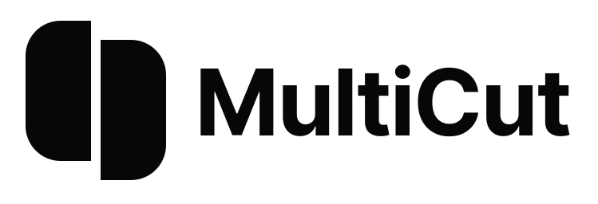

  <picture>
    <source media="(prefers-color-scheme: dark)" srcset="brand/lockup-horizontal-amber.svg">
    
  </picture>

<b>Your DJ set, cut on every drop.</b>

MultiCut lines your cameras up with the mixer recording, finds the drops, and builds the multicam edit, cut on the beat with zooms on the drops. You finish it in Premiere Pro. Everything runs on your Mac; your files never leave it.

## Download

**[Download the latest version](https://github.com/Aaron-Wickham/multicut-releases/releases/latest)**: under **Assets**, the `MultiCut-…-arm64.dmg`.

1. Open the `.dmg` and drag **MultiCut** to **Applications**.
2. Open MultiCut. The first time, if macOS says it can't check the app: **System Settings › Privacy & Security › Open Anyway**.

MultiCut checks for a newer version when it starts, and from **Help › Check for Updates…**. To update, download the new `.dmg` and drag it to Applications over the old one. Your projects stay as they are.

## What you need

- A Mac with Apple silicon (M1 or newer), macOS 13 or later
- The recording from your mixer, and your camera files
- Premiere Pro, to finish the edit

## About this repository

This repository holds MultiCut's installers only; the app's source is private. A new version is published here automatically each time a change lands, numbered `0.1.<build>`.
