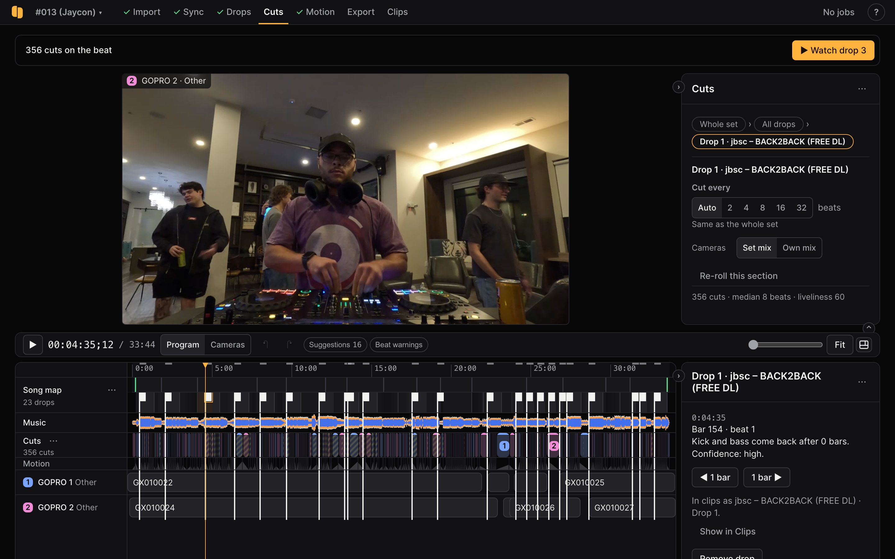

  <picture>
    <source media="(prefers-color-scheme: dark)" srcset="brand/lockup-horizontal-amber.svg">
    
  </picture>

<b>Multicam DJ sets, cut on every drop.</b>

MultiCut is a Mac app for editing DJ sets filmed on several cameras. It syncs every camera to the mixer recording, finds the drops in the music, and builds the multicam edit, cut on the beat with zooms into every drop, plus vertical clips for socials. Premiere Pro opens it finished. Everything runs on your Mac; your footage never leaves it.

**[See how it works](https://aaron-wickham.github.io/multicut-releases/)**

## Download

**[Download MultiCut](https://aaron-wickham.github.io/multicut-releases/)**, or from the [latest release](https://github.com/Aaron-Wickham/multicut-releases/releases/latest): under **Assets**, the `MultiCut-…-arm64.dmg`.

1. Open the `.dmg` and drag **MultiCut** to **Applications**.
2. Open MultiCut. The first time, if macOS says it can't check the app: **System Settings › Privacy & Security › Open Anyway**.

MultiCut checks for a newer version when it starts, and from **Help › Check for Updates…**. To update, download the new `.dmg` and drag it to Applications over the old one. Your projects stay as they are.

## What you need

- A Mac with Apple silicon (M1 or newer), macOS 13 or later
- The recording from your mixer, and your camera files
- Premiere Pro, to finish the edit

## About this repository

This repository holds MultiCut's installers and its download page (`docs/`, on GitHub Pages) only; the app's source is private. A new version is published here automatically each time a change lands, numbered `0.1.<build>`.
